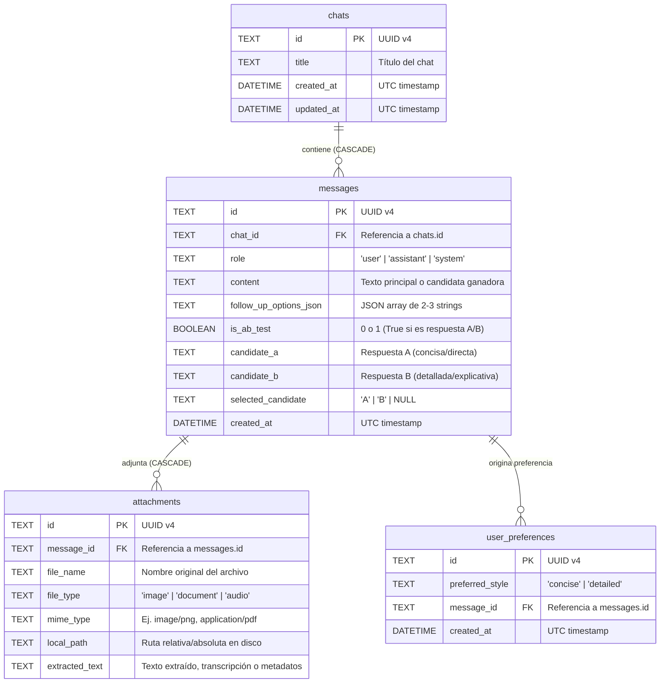

# 02 — Esquema de Base de Datos (`localgem.db`) y Contratos de API REST

**Proyecto:** LocalGem Chat  
**Base de Datos:** SQLite 3 (`backend/localgem.db`) con SQLAlchemy 2.0 ORM  
**Servidor API:** FastAPI (`http://localhost:8000`)  

---

## 1. Esquema Exacto de Base de Datos SQLite (`localgem.db`)

La base de datos consta de **4 tablas obligatorias** con integridad referencial activada (`PRAGMA foreign_keys = ON;`).

### 1.1 Diagrama Entidad-Relación (Mermaid)



---

### 1.2 Definición DDL Exacta (SQLite)

#### Tabla 1: `chats`
Almacena las sesiones de conversación.
```sql
CREATE TABLE IF NOT EXISTS chats (
    id TEXT PRIMARY KEY,
    title TEXT NOT NULL DEFAULT 'Nuevo Chat',
    created_at DATETIME NOT NULL DEFAULT CURRENT_TIMESTAMP,
    updated_at DATETIME NOT NULL DEFAULT CURRENT_TIMESTAMP
);
```

#### Tabla 2: `messages`
Almacena todos los mensajes enviados por el usuario y generados por la IA, incluyendo las opciones de seguimiento y los datos de pruebas A/B.
```sql
CREATE TABLE IF NOT EXISTS messages (
    id TEXT PRIMARY KEY,
    chat_id TEXT NOT NULL,
    role TEXT NOT NULL CHECK(role IN ('user', 'assistant', 'system')),
    content TEXT NOT NULL DEFAULT '',
    follow_up_options_json TEXT DEFAULT '[]',
    is_ab_test BOOLEAN NOT NULL DEFAULT 0,
    candidate_a TEXT DEFAULT NULL,
    candidate_b TEXT DEFAULT NULL,
    selected_candidate TEXT DEFAULT NULL CHECK(selected_candidate IN ('A', 'B') OR selected_candidate IS NULL),
    created_at DATETIME NOT NULL DEFAULT CURRENT_TIMESTAMP,
    FOREIGN KEY (chat_id) REFERENCES chats(id) ON DELETE CASCADE
);
CREATE INDEX IF NOT EXISTS idx_messages_chat_id ON messages(chat_id);
```

#### Tabla 3: `attachments`
Almacena los archivos multimodales subidos por el usuario y asociados a un mensaje específico.
```sql
CREATE TABLE IF NOT EXISTS attachments (
    id TEXT PRIMARY KEY,
    message_id TEXT NOT NULL,
    file_name TEXT NOT NULL,
    file_type TEXT NOT NULL CHECK(file_type IN ('image', 'document', 'audio')),
    mime_type TEXT NOT NULL,
    local_path TEXT NOT NULL,
    extracted_text TEXT DEFAULT '',
    FOREIGN KEY (message_id) REFERENCES messages(id) ON DELETE CASCADE
);
CREATE INDEX IF NOT EXISTS idx_attachments_message_id ON attachments(message_id);
```

#### Tabla 4: `user_preferences`
Registra el historial de elecciones del usuario en el Modo de Satisfacción A/B (`"A"` $\rightarrow$ `"concise"`, `"B"` $\rightarrow$ `"detailed"`).
```sql
CREATE TABLE IF NOT EXISTS user_preferences (
    id TEXT PRIMARY KEY,
    preferred_style TEXT NOT NULL CHECK(preferred_style IN ('concise', 'detailed')),
    message_id TEXT NOT NULL,
    created_at DATETIME NOT NULL DEFAULT CURRENT_TIMESTAMP,
    FOREIGN KEY (message_id) REFERENCES messages(id) ON DELETE CASCADE
);
CREATE INDEX IF NOT EXISTS idx_user_preferences_message_id ON user_preferences(message_id);
```

---

## 2. Reglas de Mapeo en SQLAlchemy (`backend/models.py`)

1. Todos los `id` se generan en Python mediante `str(uuid.uuid4())`.
2. En el modelo `Message`, se debe incluir una propiedad de conveniencia `@property def follow_up_options(self) -> list[str]` que deserialice `follow_up_options_json` con `json.loads()` (devolviendo `[]` si es nulo o inválido).
3. Las relaciones deben declararse con `cascade="all, delete-orphan"`:
   - `Chat.messages` $\rightarrow$ `relationship("Message", back_populates="chat", cascade="all, delete-orphan", order_by="Message.created_at")`
   - `Message.attachments` $\rightarrow$ `relationship("Attachment", back_populates="message", cascade="all, delete-orphan")`
   - `Message.preferences` $\rightarrow$ `relationship("UserPreference", back_populates="message", cascade="all, delete-orphan")`

---

## 3. Contratos de la API REST en FastAPI

Prefijo base: `/api`  
Puerto por defecto: `8000` (`http://localhost:8000`)  
Archivos estáticos servidos en: `/uploads/{filename}` para visualizar imágenes y reproducir audios subidos.

---

### 3.1 Estado de Salud y Modelos de Ollama

#### `GET /api/health`
Verifica el estado del backend, la conexión con SQLite y la disponibilidad de Ollama en `http://localhost:11434`.

- **Response `200 OK`**:
```json
{
  "status": "ok",
  "database": "connected",
  "ollama_reachable": true,
  "active_model": "llama3.2:latest",
  "available_models": ["llama3.2:latest", "llava:latest", "mistral:latest"]
}
```

#### `GET /api/models`
Lista los modelos instalados localmente en Ollama consultando `http://localhost:11434/api/tags`.

- **Response `200 OK`**:
```json
{
  "models": [
    {
      "name": "llama3.2:latest",
      "size": 2019393189,
      "modified_at": "2026-10-19T10:00:00Z"
    }
  ],
  "default_model": "llama3.2:latest"
}
```

---

### 3.2 Gestión de Chats

#### `GET /api/chats`
Obtiene todos los chats guardados ordenados por `updated_at` descendente.

- **Response `200 OK`**:
```json
[
  {
    "id": "550e8400-e29b-41d4-a716-446655440000",
    "title": "Análisis de ventas Q3 en CSV",
    "created_at": "2026-10-19T10:15:00Z",
    "updated_at": "2026-10-19T10:20:30Z",
    "message_count": 4
  }
]
```

#### `POST /api/chats`
Crea un nuevo chat vacío.

- **Request Body (`application/json`, opcional)**:
```json
{
  "title": "Nuevo Chat"
}
```
- **Response `201 Created`**:
```json
{
  "id": "550e8400-e29b-41d4-a716-446655440000",
  "title": "Nuevo Chat",
  "created_at": "2026-10-19T10:15:00Z",
  "updated_at": "2026-10-19T10:15:00Z",
  "messages": []
}
```

#### `GET /api/chats/{chat_id}`
Obtiene el detalle completo de un chat incluyendo todos sus mensajes ordenados cronológicamente y sus archivos adjuntos.

- **Response `200 OK`**:
```json
{
  "id": "550e8400-e29b-41d4-a716-446655440000",
  "title": "Explicación de arquitectura limpia",
  "created_at": "2026-10-19T10:15:00Z",
  "updated_at": "2026-10-19T10:20:30Z",
  "user_message_count": 3,
  "messages": [
    {
      "id": "msg-user-001",
      "chat_id": "550e8400-e29b-41d4-a716-446655440000",
      "role": "user",
      "content": "Explícame qué es Clean Architecture y revisa este documento",
      "follow_up_options": [],
      "is_ab_test": false,
      "candidate_a": null,
      "candidate_b": null,
      "selected_candidate": null,
      "created_at": "2026-10-19T10:15:05Z",
      "attachments": [
        {
          "id": "att-001",
          "message_id": "msg-user-001",
          "file_name": "arquitectura.pdf",
          "file_type": "document",
          "mime_type": "application/pdf",
          "local_path": "uploads/att-001_arquitectura.pdf",
          "extracted_text": "Clean Architecture separa las reglas de negocio..."
        }
      ]
    },
    {
      "id": "msg-ai-001",
      "chat_id": "550e8400-e29b-41d4-a716-446655440000",
      "role": "assistant",
      "content": "Clean Architecture es un patrón de diseño...",
      "follow_up_options": [
        "¿Cómo aplico esto en un proyecto con FastAPI?",
        "Muéstrame un ejemplo práctico de casos de uso",
        "¿Qué diferencias tiene con la Arquitectura Hexagonal?"
      ],
      "is_ab_test": false,
      "candidate_a": null,
      "candidate_b": null,
      "selected_candidate": null,
      "created_at": "2026-10-19T10:15:12Z",
      "attachments": []
    }
  ]
}
```

#### `PATCH /api/chats/{chat_id}`
Actualiza manualmente el título de un chat.

- **Request Body (`application/json`)**:
```json
{
  "title": "Nuevo título personalizado"
}
```
- **Response `200 OK`**: Objeto del chat actualizado.

#### `DELETE /api/chats/{chat_id}`
Elimina un chat, todos sus mensajes, sus registros de `attachments` y borra los archivos físicos asociados en `backend/uploads/`.

- **Response `200 OK`**:
```json
{
  "deleted": true,
  "chat_id": "550e8400-e29b-41d4-a716-446655440000"
}
```

---

### 3.3 Envío de Mensajes Multimodales y Generación de IA

#### `POST /api/chats/{chat_id}/messages`
Envía un mensaje del usuario (con texto y/o archivos multimodales), procesa los adjuntos, verifica si corresponde activar el **Modo A/B** (cada 3 mensajes del usuario o si `force_ab_test=true`), invoca a Ollama y devuelve tanto el mensaje del usuario como la respuesta del asistente con sus 2-3 opciones de seguimiento.

- **Content-Type**: `multipart/form-data`
- **Form Fields**:
  - `content` (`string`, obligatorio si no hay archivos): Texto del mensaje del usuario.
  - `force_ab_test` (`boolean`, opcional, default `false`): Si es `true` (botón "Comparar 2 respuestas"), fuerza generación dual A/B.
  - `model` (`string`, opcional): Nombre del modelo en Ollama (ej. `llama3.2:latest`). Si se omite, usa el modelo activo por defecto.
  - `files` (`list[UploadFile]`, opcional): Archivos subidos (`.png`, `.jpg`, `.webp`, `.pdf`, `.txt`, `.csv`, `.md`, `.mp3`, `.wav`, `.m4a`).

- **Lógica de Activación A/B en este Endpoint**:
  1. Se inserta el nuevo mensaje con `role = "user"` en la base de datos.
  2. Se cuenta el total de mensajes con `role = "user"` en este `chat_id` (`user_msg_count`).
  3. `should_run_ab = force_ab_test or (user_msg_count % 3 == 0)`.

- **Response `201 Created`**:
```json
{
  "chat_id": "550e8400-e29b-41d4-a716-446655440000",
  "chat_title": "Explicación de arquitectura limpia",
  "user_message_count": 3,
  "user_message": {
    "id": "msg-user-003",
    "chat_id": "550e8400-e29b-41d4-a716-446655440000",
    "role": "user",
    "content": "¿Cómo estructuro las carpetas en Python?",
    "follow_up_options": [],
    "is_ab_test": false,
    "candidate_a": null,
    "candidate_b": null,
    "selected_candidate": null,
    "created_at": "2026-10-19T10:25:00Z",
    "attachments": []
  },
  "assistant_message": {
    "id": "msg-ai-003",
    "chat_id": "550e8400-e29b-41d4-a716-446655440000",
    "role": "assistant",
    "content": "Usa una estructura de 4 capas: `domain/`, `application/`, `infrastructure/` y `presentation/`...",
    "follow_up_options": [
      "¿Qué archivos van dentro de la carpeta domain?",
      "Dame un ejemplo de repositorio en infrastructure",
      "¿Cómo inyecto dependencias con FastAPI?"
    ],
    "is_ab_test": true,
    "candidate_a": "Usa una estructura de 4 capas: `domain/` (entidades), `application/` (casos de uso), `infrastructure/` (SQLAlchemy/Ollama) y `presentation/` (rutas FastAPI).",
    "candidate_b": "Para estructurar un proyecto Python siguiendo Clean Architecture de forma profesional, te recomiendo dividir el proyecto en 4 capas concéntricas:\n\n1. **Domain (`domain/`)**: Contiene las entidades puras...\n2. **Application (`application/`)**: Orquesta los casos de uso...",
    "selected_candidate": null,
    "created_at": "2026-10-19T10:25:08Z",
    "attachments": []
  }
}
```

---

### 3.4 Selección de Respuesta en Modo A/B y Preferencias

#### `POST /api/messages/{message_id}/select-candidate`
Registra la elección del usuario entre la **Respuesta A** (concisa) y la **Respuesta B** (detallada) en un mensaje con `is_ab_test = true`.

- **Request Body (`application/json`)**:
```json
{
  "selected_candidate": "A"
}
```
*(Valores permitidos: `"A"` o `"B"`).*

- **Acciones Internas**:
  1. Verifica que `messages.id == message_id` exista y tenga `is_ab_test == True`.
  2. Actualiza `messages.selected_candidate = "A"` (o `"B"`).
  3. Actualiza `messages.content = messages.candidate_a` (si eligió `"A"`) o `messages.candidate_b` (si eligió `"B"`).
  4. Inserta un nuevo registro en `user_preferences`:
     - `id`: UUID v4
     - `preferred_style`: `"concise"` si `selected_candidate == "A"`, o `"detailed"` si `selected_candidate == "B"`.
     - `message_id`: `message_id`
     - `created_at`: UTC timestamp actual.

- **Response `200 OK`**:
```json
{
  "message": {
    "id": "msg-ai-003",
    "chat_id": "550e8400-e29b-41d4-a716-446655440000",
    "role": "assistant",
    "content": "Usa una estructura de 4 capas: `domain/` (entidades), `application/` (casos de uso), `infrastructure/` (SQLAlchemy/Ollama) y `presentation/` (rutas FastAPI).",
    "follow_up_options": [
      "¿Qué archivos van dentro de la carpeta domain?",
      "Dame un ejemplo de repositorio en infrastructure",
      "¿Cómo inyecto dependencias con FastAPI?"
    ],
    "is_ab_test": true,
    "candidate_a": "Usa una estructura de 4 capas...",
    "candidate_b": "Para estructurar un proyecto Python...",
    "selected_candidate": "A",
    "created_at": "2026-10-19T10:25:08Z",
    "attachments": []
  },
  "preference_recorded": {
    "id": "pref-001",
    "preferred_style": "concise",
    "message_id": "msg-ai-003",
    "created_at": "2026-10-19T10:25:20Z"
  }
}
```

#### `GET /api/preferences/summary`
Devuelve el resumen estadístico de preferencias del usuario para mostrar en la UI y alimentar el prompt adaptativo.

- **Response `200 OK`**:
```json
{
  "total_ab_selections": 5,
  "concise_count": 3,
  "detailed_count": 2,
  "dominant_style": "concise"
}
```
