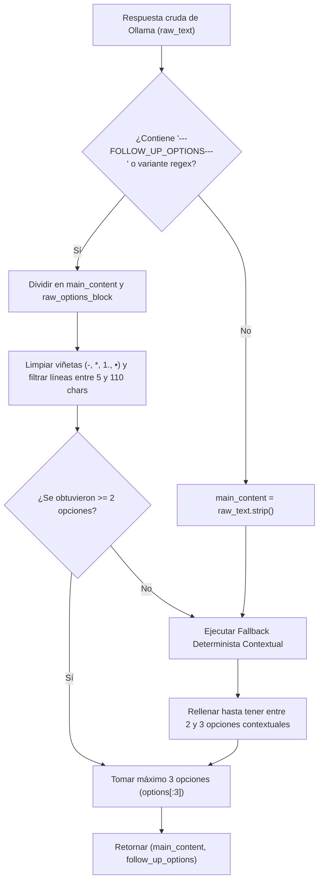
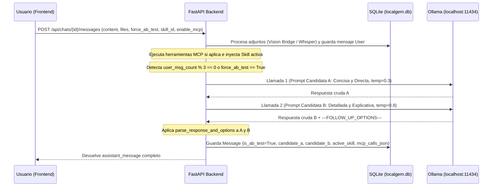
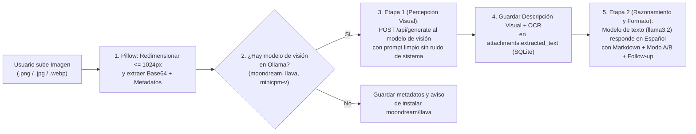

# 03 — Orquestación de IA con Ollama, Vision Bridge Multimodal, Skills y MCP

**Proyecto:** LocalGem Chat  
**Versión:** 2.1.0  
**Motor de IA y Orquestación:** Ollama Local (`http://localhost:11434`) + **LangGraph `StateGraph`** (`specs/04-langgraph-architecture.md`)  
**Objetivo:** Garantizar respuestas de alta calidad en español, soporte multimodal real mediante el **Vision Bridge (2 etapas)**, ejecución de **Skills (`SKILL.md`)**, herramientas **MCP (Model Context Protocol)**, extracción infalible de 2-3 opciones de seguimiento (`---FOLLOW_UP_OPTIONS---`) y generación dual A/B mediante un grafo de estados determinista en **LangGraph**, incluso en modelos pequeños o antiguos (`1B`–`3B`).

---

## 1. Conexión Resiliente con Ollama (`http://localhost:11434`)

### 1.1 Protocolo de Comunicación
El backend se comunica con Ollama mediante peticiones HTTP `POST` asíncronas (`httpx.AsyncClient(timeout=120.0)`) hacia los endpoints estándar:
- **URL de Chat Multi-turno:** `http://localhost:11434/api/chat`
- **URL de Generación Directa (Vision Bridge):** `http://localhost:11434/api/generate`
- **URL de Modelos Instalados:** `http://localhost:11434/api/tags`

### 1.2 Compatibilidad con Modelos Antiguos o Pequeños
Muchos usuarios ejecutan modelos ligeros en CPUs locales (ej. `llama3.2:1b`, `llama3.2:latest`, `moondream:latest`, `gemma:2b`, `phi3:mini`, `mistral:7b`, `tinyllama`, `qwen2.5:1.5b`). Estos modelos presentan limitaciones que nuestra arquitectura resuelve por diseño:
1. **No soportan `tools` nativo o `format: "json"` complejo sin degradar la respuesta**: Por ello, **NO** dependemos de JSON schemas forzados en Ollama. Utilizamos texto plano estructurado con el delimitador explícito `---FOLLOW_UP_OPTIONS---` y el **Router Híbrido MCP**.
2. **Ventana de contexto reducida**: El orquestador gestiona el historial mediante el **Context Compactor** (`MAX_HISTORY_MESSAGES = 10` o compactación inteligente) y trunca textos extraídos de documentos extensos a un máximo de **12,000 caracteres** por adjunto.
3. **Separación entre Percepción Visual (`moondream`/`llava`) y Razonamiento Verbal (`llama3.2`)**:
   - Los modelos de visión ultraligeros como `moondream` (1.8B) son excelentes describiendo imágenes cuando reciben un prompt limpio en `/api/generate`, pero colapsan si se les envía un `system` prompt largo con reglas de formato en español o si el usuario deja seleccionado un modelo de solo texto (`llama3.2`) que ignora silenciosamente el campo `images`.
   - Por ello, la Sección 7 introduce el **Vision Bridge en 2 Etapas**, que garantiza que cualquier imagen sea analizada primero por el modelo de visión instalado y cuya descripción visual detallada alimente al modelo de texto para responder en español perfecto.

### 1.3 Estructura del Payload hacia Ollama
```json
{
  "model": "llama3.2:latest",
  "stream": false,
  "options": {
    "temperature": 0.7,
    "num_ctx": 4096
  },
  "messages": [
    {
      "role": "system",
      "content": "<SYSTEM_PROMPT_CON_SKILL_Y_REGLA_DE_SEPARADOR>"
    },
    {
      "role": "user",
      "content": "<MENSAJE_DEL_USUARIO_MAS_CONTEXTO_MULTIMODAL_Y_MCP>"
    }
  ]
}
```

---

## 2. Inyección de Contexto Multimodal en el Prompt

Cuando un mensaje de usuario tiene registros asociados en la tabla `attachments`, el orquestador construye un bloque de contexto enriquecido que se antepone al mensaje del usuario:

```text
[ARCHIVOS MULTIMODALES ADJUNTOS EN ESTE MENSAJE]
1. Archivo: "diagrama_arquitectura.png" (Categoría: image | MIME: image/png)
Contenido / Contexto extraído:
---
[Imagen adjunta: 'diagrama_arquitectura.png' | Formato: PNG | dimensiones 920x640px]
[Análisis Visual IA (moondream:latest)]:
La imagen muestra un diagrama de arquitectura de tres capas con un cliente Next.js a la izquierda, un servidor FastAPI en el centro y una base de datos SQLite junto a Ollama a la derecha...
---

2. Archivo: "nota_voz_reunion.wav" (Categoría: audio | MIME: audio/wav)
Contenido / Contexto extraído:
---
[Transcripción de audio 'nota_voz_reunion.wav' (Duración: 8.4s, Idioma: es)]:
Necesitamos priorizar el módulo de reportes para el viernes...
---

Analiza la imagen y dime si coincide con lo mencionado en el audio.
```

---

## 3. El Separador `---FOLLOW_UP_OPTIONS---` y Fallback Automático por Código

### 3.1 Instrucción en el System Prompt
Todo prompt enviado a Ollama incluye la siguiente directiva obligatoria al final del `system` prompt:

```text
REGLA OBLIGATORIA DE OPCIONES DE SEGUIMIENTO:
Primero desarrolla tu respuesta completa y natural a la consulta del usuario.
Únicamente al final de tu respuesta, en una línea nueva separada, escribe exactamente:
---FOLLOW_UP_OPTIONS---
Y justo debajo escribe 3 opciones cortas (una por línea, sin viñetas ni numeración, máximo 75 caracteres) que el usuario pueda hacer clic para continuar la conversación.
```

### 3.2 Algoritmo de Extracción y Fallback Determinista (`parse_response_and_options`)



---

## 4. Flujo de Generación Dual para el Modo de Satisfacción A/B

### 4.1 Condiciones de Disparo
El Modo de Satisfacción A/B se activa cuando se cumple cualquiera de estas dos condiciones al recibir un mensaje del usuario en `POST /api/chats/{chat_id}/messages`:
1. **Automático cada 3 mensajes del usuario**: `user_message_count % 3 == 0`.
2. **Manual por el usuario**: El usuario activó el botón **"Comparar 2 respuestas"** (`force_ab_test == True`).

### 4.2 Arquitectura del Flujo Dual (Candidata A vs Candidata B)



---

## 5. Context Compactor — Gestión Inteligente del Historial Largo

El Context Compactor se activa antes de construir el payload hacia Ollama cuando:
1. El chat tiene al menos `COMPACTION_THRESHOLD` (default `14`) mensajes, o
2. El tamaño estimado del historial supera `TOKEN_BUDGET` (default `3200`) tokens.

Cuando se activa, resume los mensajes antiguos con `temperature=0.2`, guarda el resumen en `chats.context_summary` y preserva íntegros los últimos `RECENT_WINDOW_AFTER_COMPACTION` (`4`) mensajes recientes.

---

## 6. Prompt Enhancer — Enriquecimiento Determinista de Mensajes

Clasifica la intención del usuario (`GENERACIÓN_DE_CÓDIGO`, `ANÁLISIS_DE_DATOS`, `COMPARACIÓN`, `EXPLICACIÓN_CONCEPTUAL`, `TRADUCCIÓN_O_IDIOMA`, `GENERAL`) e inyecta el contexto de sesión en el System Prompt sin llamadas adicionales al LLM.

---

## 7. Vision Bridge — Pipeline Multimodal de Visión en 2 Etapas y Audio Resiliente (v2.0)

### 7.1 Problema Resuelto
1. En Ollama, los modelos de texto (`llama3.2:latest`, `llama3.2:1b`) **no devuelven error HTTP 400** cuando reciben el campo `images`: simplemente ignoran la imagen y responden a ciegas.
2. Por otro lado, los modelos de visión ultraligeros (`moondream:latest`) están entrenados para recibir un prompt directo sobre la imagen en `/api/generate` y **se degradan severamente** si se les inyecta un `system` prompt largo con reglas de formato o instrucciones A/B.

### 7.2 Arquitectura del Vision Bridge en 2 Etapas



### 7.3 Reglas de Selección Automática de Modelos en el Vision Bridge
1. **Detección de Modelos de Visión (`VISION_MODEL_FAMILIES`)**:
   Se consideran modelos con soporte de visión nativo aquellos cuyo nombre contenga: `moondream`, `llava`, `bakllava`, `minicpm-v`, `llama3.2-vision`, `qwen2.5vl`, `qwen2-vl` o `pixtral`.
2. **Etapa 1 — Extracción Visual Limpia (`analyze_image_with_vision_model`)**:
   - Al procesar una imagen subida, el backend busca el primer modelo de visión instalado en Ollama (priorizando el modelo solicitado por el usuario si es de visión, o `moondream` / `llava` automáticamente).
   - Realiza una llamada a `POST http://localhost:11434/api/generate` con `stream=False`, `images=[base64_str]` y un prompt directo libre de metadatos:
     `"Describe this image in detail. Identify all visible objects, people, colors, text, numbers, diagrams, and spatial relationships."`
   - El resultado devuelto por el modelo de visión se adjunta a `extracted_text` bajo el encabezado `[Análisis Visual IA (<modelo_visión>)]`.
3. **Etapa 2 — Síntesis y Respuesta en Español**:
   - Si el usuario tenía seleccionado un modelo de solo texto (`llama3.2` o `llama3.2:1b`), este recibe el `[Análisis Visual IA]` dentro del contexto del mensaje y responde la consulta del usuario en español impecable.
   - Si el usuario tenía seleccionado `moondream` en el selector de la UI y en Ollama existe también un modelo de texto (`llama3.2` o `llama3.2:1b`), `moondream` actúa como el motor visual de Etapa 1 y el modelo de texto actúa como sintetizador de Etapa 2 para garantizar que la respuesta esté en español, respete el Modo A/B y genere siempre las 3 opciones de `---FOLLOW_UP_OPTIONS---`.

### 7.4 Procesamiento de Audio Local Libre de Symlinks en Windows
1. En Windows sin "Modo Desarrollador" o privilegios de Administrador, `huggingface_hub` falla con `WinError 1314` al crear enlaces simbólicos para `faster-whisper`.
2. El procesador multimodal configura explícitamente `HF_HUB_DISABLE_SYMLINKS_WARNING=1`, `KMP_DUPLICATE_LIB_OK=TRUE` y pasa `download_root=str(BACKEND_DIR / "models_cache" / "whisper")` al instanciar `WhisperModel`, almacenando los pesos directamente en disco local sin usar symlinks.
3. Si un archivo `.wav` PCM estándar no pudiera ser procesado por `faster-whisper`, se extrae su información acústica (`wave`) y se informa con claridad. Además, el frontend incorpora grabación nativa de notas de voz en formato `.wav` PCM (16 kHz mono) directamente desde el micrófono del navegador.

---

## 8. Sistema de Skills Modulares (`SKILL.md`) (v2.0)

### 8.1 Estructura de un Archivo `SKILL.md`
Las Skills residen en `backend/skills/<skill_id>/SKILL.md` y constan de un bloque YAML frontmatter seguido de las instrucciones Markdown:

```markdown
---
id: code-architect
name: Arquitecto de Software
description: Experto en diseño de sistemas, Clean Architecture, código limpio y resolución de bugs.
icon: Code2
category: engineering
triggers:
  - código
  - arquitectura
  - función
  - bug
  - error
  - fastapi
  - nextjs
  - sql
---
# Rol: Arquitecto de Software Principal
1. Estructura tus respuestas técnicas con claridad arquitectónica.
2. Cuando escribas código, incluye buenas prácticas, tipado estricto y comentarios breves explicando el porqué.
3. Señala posibles cuellos de botella de rendimiento o seguridad.
```

### 8.2 Inyección en el System Prompt
Cuando una Skill está activa (por selección manual del usuario o por auto-detección cuando `skill_id == "auto"`), sus instrucciones se inyectan en `build_system_prompt()` dentro del bloque:
```text
[SKILL ESPECIALIZADA ACTIVA: {skill.name}]
{skill.instructions}
[FIN DE SKILL ESPECIALIZADA]
```

---

## 9. Orquestación Híbrida MCP (Model Context Protocol) (v2.0)

### 9.1 Arquitectura del Router Híbrido MCP
Para que los modelos locales pequeños (`llama3.2:1b`, `llama3.2:3b`) aprovechen herramientas del mundo real con **0% de fallos de formato JSON**, el servicio `backend/services/mcp_service.py` implementa un **Router Híbrido MCP**:

1. **Catálogo Estándar MCP (`tools/list`)**:
   - `mcp_system_time`: Hora local, fecha, día de la semana, sistema operativo y estado de recursos.
   - `mcp_calculator`: Evaluación matemática segura (`sin`, `cos`, `sqrt`, `log`, porcentajes, interés compuesto, estadísticas).
   - `mcp_sqlite_inspector`: Estadísticas en vivo e inspección solo-lectura de la base de datos `localgem.db` (conteo de chats, mensajes, adjuntos, preferencias A/B y esquema de tablas).
   - `mcp_workspace_reader`: Listado y lectura segura de archivos de documentación/especificaciones del proyecto (`/specs`, `README.md`, `uploads/`).
   - `mcp_wikipedia_search`: Consulta en vivo a la API pública REST de Wikipedia (ES/EN) para obtener datos enciclopédicos verificados.
2. **Ejecución Pre-Inferencia y Post-Tag (`tools/call`)**:
   - Antes de llamar a Ollama, si `enable_mcp=True`, el router analiza la consulta del usuario y ejecuta de forma determinista las herramientas MCP necesarias (o permite llamadas explícitas).
   - Los resultados reales obtenidos se inyectan en el prompt bajo `[RESULTADOS VERIFICADOS DE HERRAMIENTAS MCP]` y se guardan en `messages.mcp_calls_json` para que el frontend renderice los badges de trazabilidad MCP.

---

## 10. Delegación del Pipeline al Grafo de Estados LangGraph (v2.1)

A partir de la versión 2.1.0, todas las etapas descritas en las Secciones 1 a 9 (Resolución de Modelo, Skills `SKILL.md`, Router Híbrido MCP, Vision Bridge en 2 Etapas, Compactación de Contexto, Generación Estándar vs. Dual A/B y Parser de `---FOLLOW_UP_OPTIONS---`) son orquestadas por la máquina de estados compilada en `backend/services/langgraph_service.py` utilizando **LangGraph** (`StateGraph(LocalGemGraphState)`).

- Consulta **[04-langgraph-architecture.md](./04-langgraph-architecture.md)** para la especificación completa de `LocalGemGraphState`, los 9 nodos del grafo, las 4 aristas condicionales, la telemetría `graph_trace` y el endpoint `GET /api/graph/schema`.

