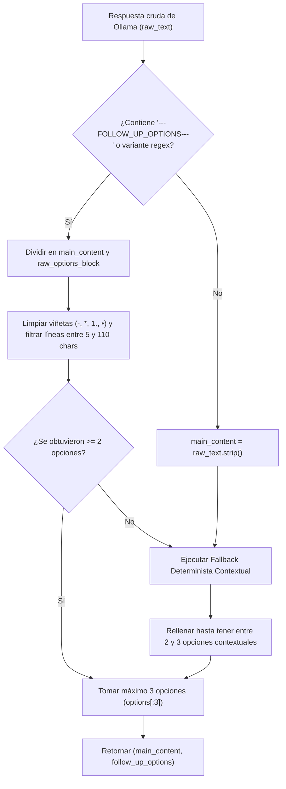
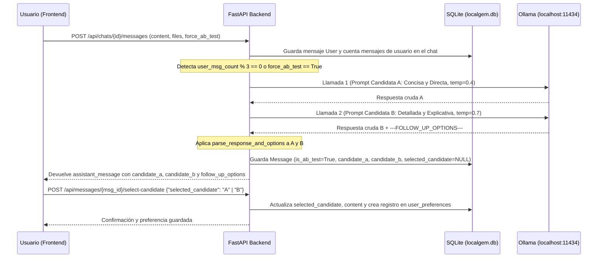

# 03 — Orquestación de IA con Ollama, Extracción de Opciones y Flujo Dual A/B

**Proyecto:** LocalGem Chat  
**Motor de IA:** Ollama Local (`http://localhost:11434/api/chat`)  
**Objetivo:** Garantizar respuestas de alta calidad, soporte multimodal, extracción infalible de 2-3 opciones de seguimiento (`---FOLLOW_UP_OPTIONS---`) y generación dual A/B incluso en modelos pequeños o antiguos.

---

## 1. Conexión Resiliente con Ollama (`http://localhost:11434/api/chat`)

### 1.1 Protocolo de Comunicación
El backend se comunica con Ollama mediante peticiones HTTP `POST` asíncronas (`httpx.AsyncClient(timeout=120.0)`) hacia el endpoint estándar:
- **URL de Chat:** `http://localhost:11434/api/chat`
- **URL de Modelos Instalados:** `http://localhost:11434/api/tags`

### 1.2 Compatibilidad con Modelos Antiguos o Pequeños
Muchos usuarios ejecutan modelos ligeros o antiguos en CPUs locales (ej. `llama3.2:1b`, `gemma:2b`, `phi3:mini`, `mistral:7b`, `tinyllama`, `qwen2:1.5b`). Estos modelos presentan tres limitaciones comunes que nuestra arquitectura resuelve por diseño:
1. **No soportan `tools` o `format: "json"` complejo sin degradar la respuesta**: Por ello, **NO** dependemos de llamadas a funciones (function calling) ni de JSON schemas forzados en Ollama. Utilizamos texto plano estructurado con el delimitador explícito `---FOLLOW_UP_OPTIONS---`.
2. **Ventana de contexto reducida**: El orquestador limita el historial enviado a Ollama a los últimos **10 mensajes** del chat actual (`MAX_HISTORY_MESSAGES = 10`) y trunca textos extraídos de documentos muy extensos a un máximo de **12,000 caracteres** por adjunto para evitar desbordar el contexto.
3. **Resolución Dinámica de Modelo (Auto-Discovery)**:
   - Antes de invocar `/api/chat`, si el modelo configurado por defecto (ej. `llama3.2`) no está instalado, el orquestador consulta `GET http://localhost:11434/api/tags` y selecciona automáticamente el primer modelo disponible en la máquina del usuario.
   - Si un mensaje incluye imágenes en Base64 (`images`) pero el modelo activo es solo de texto y Ollama devuelve un error HTTP `400` o `500`, el orquestador **reintenta automáticamente la petición sin el campo `images`**, utilizando únicamente los metadatos e información del archivo inyectados en `extracted_text`.

### 1.3 Estructura del Payload hacia Ollama
```json
{
  "model": "llama3.2:latest",
  "stream": false,
  "options": {
    "temperature": 0.7,
    "num_ctx": 4096
  },
  "messages": [
    {
      "role": "system",
      "content": "<SYSTEM_PROMPT_CON_REGLA_DE_SEPARADOR>"
    },
    {
      "role": "user",
      "content": "<MENSAJE_DEL_USUARIO_MAS_TEXTO_EXTRAIDO_DE_ADJUNTOS>",
      "images": ["<BASE64_STRING_OPCIONAL>"]
    }
  ]
}
```

---

## 2. Inyección de Contexto Multimodal en el Prompt

Cuando un mensaje de usuario tiene registros asociados en la tabla `attachments`, el orquestador construye un bloque de contexto enriquecido que se antepone al mensaje del usuario:

```text
[ARCHIVOS ADJUNTOS EN ESTE MENSAJE]
1. Archivo: "informe_ventas.csv" (Tipo: document | MIME: text/csv)
Contenido extraído:
---
mes,ventas,region
Enero,14500,Norte
...
---

2. Archivo: "nota_voz_reunion.wav" (Tipo: audio | MIME: audio/wav)
Transcripción / Información de audio:
---
"Necesitamos priorizar el módulo de reportes para el viernes..."
---

[MENSAJE DEL USUARIO]
Analiza las ventas y dime si coinciden con lo mencionado en el audio.
```

---

## 3. El Separador `---FOLLOW_UP_OPTIONS---` y Fallback Automático por Código

### 3.1 Instrucción en el System Prompt
Todo prompt enviado a Ollama incluye la siguiente directiva obligatoria al final del `system` prompt (y un recordatorio al final del último mensaje `user` para modelos pequeños con poca atención al system prompt):

```text
REGLA OBLIGATORIA DE FORMATO:
Responde siempre en español (a menos que el usuario pida otro idioma).
Al terminar tu respuesta principal, DEBES escribir exactamente el separador en una línea nueva:
---FOLLOW_UP_OPTIONS---
Debajo de ese separador, escribe entre 2 y 3 preguntas o acciones cortas (máximo 80 caracteres cada una, una por línea, sin numeración pesada) que el usuario podría hacer a continuación para profundizar en el tema.

Ejemplo de final de respuesta:
...espero que esta explicación te sea útil.

---FOLLOW_UP_OPTIONS---
¿Puedes darme un ejemplo práctico en código?
¿Cuáles son las ventajas principales de este enfoque?
¿Cómo puedo optimizar su rendimiento?
```

### 3.2 Algoritmo de Extracción y Fallback Determinista (`parse_response_and_options`)

Dado que los modelos antiguos o pequeños pueden:
- Olvidar por completo escribir `---FOLLOW_UP_OPTIONS---`,
- Escribir una variante ligeramente alterada (como `--- FOLLOW_UP_OPTIONS ---`, `FOLLOW_UP_OPTIONS:`, `***FOLLOW_UP_OPTIONS***`), o
- Escribir menos de 2 opciones válidas,

el backend implementa la función `parse_response_and_options(raw_text: str, user_prompt: str) -> tuple[str, list[str]]` con **3 capas de seguridad**:



#### Reglas Exactas del Parser y Fallback por Código:
1. **Detección Flexible con Regex**:
   Se busca el patrón `r"(?i)[-_*]{0,3}\s*FOLLOW[_\s-]*UP[_\s-]*OPTIONS\s*[-_*:]{0,3}"`.
2. **Limpieza de Opciones Extraídas**:
   Si se encuentra el separador:
   - `main_content` es todo el texto anterior al separador (`.strip()`).
   - Se procesa el texto posterior línea por línea, eliminando prefijos como `- `, `* `, `• `, `1. `, `2) `, comillas envolventes y líneas vacías.
3. **Fallback Automático por Código (Si no hay separador o hay < 2 opciones)**:
   Si tras el parseo la lista tiene menos de 2 elementos, el código genera opciones contextuales basadas en el mensaje del usuario y el contenido generado:
   - Si el mensaje involucra código o programación:
     1. `"Muéstrame un ejemplo práctico de código paso a paso"`
     2. `"¿Cómo puedo probar y depurar esta implementación?"`
     3. `"¿Qué buenas prácticas o mejoras recomiendas aplicar aquí?"`
   - Si el mensaje incluye documentos, datos o imágenes adjuntas:
     1. `"Haz un resumen ejecutivo con los puntos clave del archivo"`
     2. `"¿Qué conclusiones o acciones recomiendas a partir de esto?"`
     3. `"Explícame con más detalle el punto más importante"`
   - Para cualquier otro tema general (extrae el tema clave del `user_prompt`):
     1. `"Explícame este tema con un ejemplo práctico"`
     2. `"Haz un resumen en puntos clave fáciles de recordar"`
     3. `"¿Cuáles son los aspectos más avanzados sobre esto?"`
4. **Garantía de Contrato**: La función **nunca** devuelve menos de 2 ni más de 3 strings en `follow_up_options`, y el separador `---FOLLOW_UP_OPTIONS---` **nunca** queda visible dentro de `main_content`.

---

## 4. Flujo de Generación Dual para el Modo de Satisfacción A/B

### 4.1 Condiciones de Disparo
El Modo de Satisfacción A/B se activa cuando se cumple cualquiera de estas dos condiciones al recibir un mensaje del usuario en `POST /api/chats/{chat_id}/messages`:
1. **Automático cada 3 mensajes del usuario**: `user_message_count % 3 == 0` (es decir, en el mensaje #3, #6, #9, #12... del usuario dentro de ese chat).
2. **Manual por el usuario**: El usuario activó el botón **"Comparar 2 respuestas"** en la UI (`force_ab_test == True`).

### 4.2 Arquitectura del Flujo Dual (Candidata A vs Candidata B)



*(Nota de rendimiento para hardware local: Las llamadas para la Candidata A y la Candidata B se ejecutan de forma secuencial en el backend porque Ollama en equipos locales procesa una inferencia a la vez en GPU/CPU; esto evita timeouts por encolamiento y reduce el consumo pico de RAM).*

### 4.3 Prompts Especializados para Candidata A y Candidata B

#### Prompt para **Respuesta A (Concisa / Directa)**:
```text
MODO DE ESTILO: CONCISO Y DIRECTO (CANDIDATA A).
Instrucciones estrictas:
- Ve directamente al grano en el primer párrafo.
- Usa respuestas breves, ejecutivas y listas con viñetas cortas si es necesario.
- Evita introducciones largas, rellenos o explicaciones teóricas extensas.
- Limita tu respuesta a lo esencial y accionable.
```

#### Prompt para **Respuesta B (Detallada / Explicativa)**:
```text
MODO DE ESTILO: DETALLADO Y EXPLICATIVO (CANDIDATA B).
Instrucciones estrictas:
- Proporciona una explicación completa, didáctica y bien estructurada con subtítulos en Markdown.
- Incluye contexto, el "por qué" detrás de cada concepto y ejemplos prácticos o analogías.
- Desglosa la respuesta paso a paso para que no quede ninguna duda.
- Al final de tu respuesta incluye el bloque ---FOLLOW_UP_OPTIONS--- con 3 opciones de seguimiento.
```

### 4.4 Aprendizaje de Preferencias del Usuario (`user_preferences`)
Para las respuestas normales (cuando `is_ab_test == False`), el orquestador consulta la tabla `user_preferences`:
- Si el usuario tiene más selecciones de tipo `"concise"` que `"detailed"`, se inyecta automáticamente en el `system` prompt:
  `"Preferencia aprendida del usuario: El usuario prefiere respuestas CONCISAS, directas y al grano."`
- Si el usuario tiene más selecciones de tipo `"detailed"`, se inyecta:
  `"Preferencia aprendida del usuario: El usuario prefiere respuestas DETALLADAS, estructuradas y con ejemplos explicativos."`
- Si aún no hay registros en `user_preferences` (o hay empate), se utiliza un estilo equilibrado por defecto.
