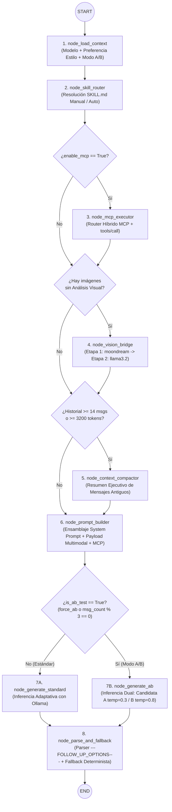

# 04 — Arquitectura de Orquestación Agéntica con LangGraph (`StateGraph`)

> **Proyecto:** LocalGem Chat — Clon Local de Google Gemini  
> **Versión:** 2.1.0 (Evolución SDD a Grafo de Estados Determinista con LangGraph)  
> **Documento:** Especificación de Grafo de Estados, Nodos, Aristas Condicionales, Trazabilidad y Resiliencia Local.

---

## 1. Justificación Arquitectónica: ¿Por qué LangGraph en LocalGem Chat?

En la versión 2.0 de **LocalGem Chat**, el flujo de respuesta del asistente combinaba múltiples subsistemas avanzados dentro de un pipeline procedimental en `backend/services/ollama_service.py`:
1. Resolución de modelo activo y preferencias adaptativas del usuario (`user_preferences`).
2. Detección e inyección de **Skills modulares** (`SKILL.md`).
3. Enrutamiento y ejecución de **Herramientas MCP** (`mcp_service.py`).
4. **Vision Bridge** en 2 etapas (`moondream:latest` $\rightarrow$ `llama3.2`).
5. **Compactación de Contexto** para historiales extensos.
6. **Generación Estándar vs. Dual A/B** (`compare_mode` o cada 3 mensajes).
7. **Parser Tolerante a Fallos** para `---FOLLOW_UP_OPTIONS---`.

Al escalar estas capacidades, un flujo procedimental (`if/else` secuencial) dificulta la trazabilidad por etapa, el aislamiento de fallos y la visualización académica del comportamiento del agente.

**LangGraph** (de LangChain AI) resuelve este problema modelando la orquestación como una **Máquina de Estados Finitos Dirigida (`StateGraph`)**:
- **Estado Tipado Centralizado (`LocalGemGraphState`)**: Un único diccionario fuertemente tipado (`TypedDict`) viaja por todo el grafo; cada nodo lee solo lo que necesita y devuelve actualizaciones parciales inmutables.
- **Nodos Atómicos con Responsabilidad Única (SRP)**: Cada capacidad (Skill Router, MCP Executor, Vision Bridge, Context Compactor, Generador Estándar, Generador Dual A/B y Parser de Opciones) es un nodo independiente, testeable de forma aislada y medible en milisegundos.
- **Aristas Condicionales (`add_conditional_edges`)**: Las decisiones de negocio (¿hay imágenes sin OCR visual?, ¿está activo MCP?, ¿toca test A/B cada 3 mensajes?) dejan de estar ocultas en funciones anidadas y pasan a ser **rutas explícitas del grafo**.
- **Observabilidad y Auditoría (`graph_trace`)**: Cada ejecución del grafo registra qué nodos se visitaron y cuánto tardó cada uno (`duration_ms`), permitiendo exponer el diagrama Mermaid en vivo y auditar el razonamiento del agente.

---

## 2. Definición del Estado del Grafo (`LocalGemGraphState`)

El archivo `backend/services/langgraph_service.py` debe definir el siguiente esquema `TypedDict` que representa la memoria de trabajo de un turno de conversación:

```python
from typing import Any, Dict, List, Optional, TypedDict


class GraphNodeTrace(TypedDict):
    node: str
    status: str          # "ok" | "skipped" | "fallback" | "error"
    duration_ms: int
    detail: Optional[str]


class LocalGemGraphState(TypedDict, total=False):
    # --- 1. Entradas del Turno (Inputs) ---
    chat_id: str
    user_message_id: str
    user_content: str
    requested_model: str
    skill_id: Optional[str]
    enable_mcp: bool
    force_ab_test: bool
    user_message_count: int
    history_messages: List[Dict[str, Any]]
    current_attachments: List[Dict[str, Any]]

    # --- 2. Estado Enriquecido por Nodos Intermedios ---
    active_model: str
    synthesis_model: str
    preferred_style: Optional[str]       # "concise" | "detailed" | None
    active_skill_meta: Optional[Dict[str, Any]]
    active_skill_id: Optional[str]
    mcp_tool_calls: List[Dict[str, Any]]
    mcp_context_block: str
    vision_bridge_applied: bool
    compacted_summary: Optional[str]
    ollama_messages: List[Dict[str, Any]]
    is_ab_test: bool

    # --- 3. Salidas de Generación y Post-Procesamiento (Outputs) ---
    raw_response_main: str
    raw_response_b: Optional[str]
    final_content: str
    candidate_a: Optional[str]
    candidate_b: Optional[str]
    follow_up_options: List[str]

    # --- 4. Telemetría y Manejo de Errores del Grafo ---
    graph_trace: List[GraphNodeTrace]
    error: Optional[str]
```

---

## 3. Topología del Grafo (`StateGraph`) y Diagrama Oficial

### 3.1 Diagrama de Flujo del Agente LangGraph



---

## 4. Especificación Detallada de Nodos y Aristas Condicionales

### Nodo 1: `node_load_context`
- **Entrada**: `requested_model`, `force_ab_test`, `user_message_count`, `preferred_style`.
- **Responsabilidad**:
  1. Invoca `resolve_active_model(requested_model)` contra Ollama (`/api/tags`) con fallback automático al primer modelo instalado si el solicitado no existe.
  2. Evalúa la regla de negocio de activación A/B:
     $$\text{is\_ab\_test} = \text{force\_ab\_test} \lor (\text{user\_message\_count} > 0 \land \text{user\_message\_count} \bmod 3 == 0)$$
  3. Inicializa `graph_trace = []` y registra la ejecución del nodo.
- **Salida parcial**: `active_model`, `synthesis_model`, `is_ab_test`, `graph_trace`.

### Nodo 2: `node_skill_router`
- **Entrada**: `skill_id`, `user_content`, `current_attachments`.
- **Responsabilidad**:
  1. Consulta `skills_service.resolve_skill(skill_id, user_content, attachment_types)`.
  2. Soporta selección manual (`skill_id` explícito), comandos slash (`/code`, `/data`, `/tutor`, `/sql`) o auto-detección léxica y por extensión de adjunto (`"auto"` o `None`).
- **Salida parcial**: `active_skill_meta`, `active_skill_id`, actualización de `graph_trace`.

### Arista Condicional 1: `route_mcp_check(state)`
- Si `state.get("enable_mcp", True)` es verdadero $\rightarrow$ dirige a `node_mcp_executor`.
- En caso contrario $\rightarrow$ dirige al chequeo de Vision Bridge (`route_vision_check`).

### Nodo 3: `node_mcp_executor`
- **Entrada**: `user_content`, `chat_id`, `enable_mcp`.
- **Responsabilidad**:
  1. Invoca `mcp_service.detect_and_run_mcp_tools(user_content, chat_id)` con un timeout máximo de 8 segundos por herramienta.
  2. Formatea las salidas verificadas en el bloque `[RESULTADOS VERIFICADOS DE HERRAMIENTAS MCP]` (`mcp_context_block`) y almacena la lista estructurada en `mcp_tool_calls`.
- **Salida parcial**: `mcp_tool_calls`, `mcp_context_block`, actualización de `graph_trace`.

### Arista Condicional 2: `route_vision_check(state)`
- Inspecciona `current_attachments`:
  - Si existe algún adjunto con `file_type == "image"` cuyo `extracted_text` aún no contenga `[Análisis Visual IA`, **o** si el usuario seleccionó `moondream` en la UI y existe un modelo de texto (`llama3.2`) disponible para sintetizar en español $\rightarrow$ dirige a `node_vision_bridge`.
  - En caso contrario $\rightarrow$ dirige al chequeo de compactación (`route_compaction_check`).

### Nodo 4: `node_vision_bridge`
- **Entrada**: `current_attachments`, `user_content`, `active_model`.
- **Responsabilidad**:
  1. **Etapa 1 (Percepción Visual)**: Para cada imagen que no tenga aún descripción visual en `extracted_text`, ejecuta `describe_image_with_vision_model()` usando `moondream:latest` (o el modelo de visión instalado) con la pregunta actual del usuario.
  2. **Etapa 2 (Conmutación de Modelo Sintetizador)**: Si `active_model` es un modelo exclusivamente visual en inglés (`moondream`), conmuta `synthesis_model` a `llama3.2:latest` o `llama3.2:1b` para garantizar que la síntesis final, el Modo A/B y las opciones `---FOLLOW_UP_OPTIONS---` se generen en español impecable.
- **Salida parcial**: `current_attachments`, `synthesis_model`, `vision_bridge_applied = True`, actualización de `graph_trace`.

### Arista Condicional 3: `route_compaction_check(state)`
- Calcula el número de mensajes en `history_messages` y la estimación de tokens ($\approx \text{caracteres} / 4$).
- Si `len(history_messages) >= 14` o `estimated_tokens >= 3200` $\rightarrow$ dirige a `node_context_compactor`.
- En caso contrario $\rightarrow$ dirige directamente a `node_prompt_builder`.

### Nodo 5: `node_context_compactor`
- **Entrada**: `history_messages`, `synthesis_model`.
- **Responsabilidad**:
  1. Separa los mensajes antiguos de los últimos 6 mensajes recientes.
  2. Genera un resumen ejecutivo conciso (máximo 200 palabras) de los mensajes antiguos o aplica un resumen extractivo instantáneo si el modelo está ocupado, evitando desbordar la ventana de contexto y manteniendo baja latencia en CPU/RAM de 16 GB.
- **Salida parcial**: `compacted_summary`, `history_messages` (recortados a los 6 más recientes), actualización de `graph_trace`.

### Nodo 6: `node_prompt_builder`
- **Entrada**: `preferred_style`, `active_skill_meta`, `compacted_summary`, `history_messages`, `user_content`, `current_attachments`, `mcp_context_block`, `synthesis_model`.
- **Responsabilidad**:
  1. Construye el System Prompt unificado con:
     - Directivas base de **LocalGem** en español.
     - Estilo adaptativo aprendido (`concise` o `detailed`).
     - Instrucciones del `SKILL.md` activo (`[SKILL ESPECIALIZADA ACTIVA]`).
     - Resumen de contexto compactado (`[RESUMEN DE CONTEXTO PREVIO]`) si existe.
     - Regla de formato estricto para `---FOLLOW_UP_OPTIONS---`.
  2. Construye el arreglo `ollama_messages` inyectando en el último turno del usuario:
     - El bloque `[ARCHIVOS ADJUNTOS EN ESTE MENSAJE]` (con `[Análisis Visual IA]`, texto de PDF/CSV o transcripción de `faster-whisper`).
     - El bloque `[RESULTADOS VERIFICADOS DE HERRAMIENTAS MCP]` si el nodo MCP devolvió datos.
     - La directiva de anclaje `[INTENCIÓN CENTRAL DE LA SESIÓN]` para evitar deriva temática.
- **Salida parcial**: `ollama_messages`, actualización de `graph_trace`.

### Arista Condicional 4: `route_generation_mode(state)`
- Si `state.get("is_ab_test")` es `True` $\rightarrow$ dirige a `node_generate_ab`.
- Si `state.get("is_ab_test")` es `False` $\rightarrow$ dirige a `node_generate_standard`.

### Nodo 7A: `node_generate_standard`
- **Entrada**: `synthesis_model`, `ollama_messages`, `preferred_style`.
- **Responsabilidad**:
  1. Invoca al motor local de Ollama (`ChatOllama` de `langchain_ollama` o cliente asíncrono `httpx` contra `POST /api/chat`) con `temperature = 0.4` (si `preferred_style == "concise"`) o `temperature = 0.65` (por defecto / `"detailed"`).
  2. Si ocurre un error de conexión o memoria en Ollama, devuelve un mensaje de degradación elegante sin lanzar una excepción no controlada.
- **Salida parcial**: `raw_response_main`, actualización de `graph_trace`.

### Nodo 7B: `node_generate_ab`
- **Entrada**: `synthesis_model`, `ollama_messages`.
- **Responsabilidad**:
  1. Construye dos variantes del System Prompt:
     - **Candidata A (Concisa y Directa)**: `temperature = 0.3`, máximo 2 párrafos o lista puntual al grano.
     - **Candidata B (Detallada y Estructurada)**: `temperature = 0.8`, explicación profunda con subtítulos, ejemplos y desglose paso a paso.
  2. Ejecuta ambas generaciones contra Ollama de forma secuencial controlada (para no saturar la RAM en equipos de 16 GB).
- **Salida parcial**: `raw_response_main` (Candidata A), `raw_response_b` (Candidata B), actualización de `graph_trace`.

### Nodo 8: `node_parse_and_fallback`
- **Entrada**: `raw_response_main`, `raw_response_b`, `is_ab_test`, `user_content`.
- **Responsabilidad**:
  1. Ejecuta `parse_response_and_options(raw_response_main, user_query=user_content)` para separar el cuerpo Markdown limpio de las 2–3 opciones clicables (`---FOLLOW_UP_OPTIONS---`).
  2. Si `is_ab_test == True`, limpia también `raw_response_b` con `parse_response_and_options()` y asigna `candidate_a` y `candidate_b`.
  3. Garantiza por contrato que `follow_up_options` tenga siempre entre 2 y 3 elementos válidos en español (usando el generador de fallback determinista si el modelo pequeño omitió el delimitador).
- **Salida parcial**: `final_content`, `candidate_a`, `candidate_b`, `follow_up_options`, actualización de `graph_trace`.

---

## 5. Contrato de API para Inspección del Grafo (`GET /api/graph/schema`)

Para demostrar visualmente la arquitectura de **LangGraph** ante el docente y en el panel de herramientas de la UI, el backend debe exponer el endpoint:

### `GET /api/graph/schema`
Devuelve la estructura viva del `StateGraph` compilado en `langgraph_service.py`, incluyendo la definición Mermaid lista para renderizar y el catálogo de nodos.

- **Response `200 OK`**:
```json
{
  "engine": "LangGraph StateGraph",
  "version": "2.1.0",
  "state_schema": "LocalGemGraphState",
  "nodes": [
    {
      "id": "node_load_context",
      "label": "Carga de Contexto y Preferencias",
      "description": "Resuelve el modelo activo en Ollama, carga el estilo preferido del usuario y evalúa la condición de Test A/B."
    },
    {
      "id": "node_skill_router",
      "label": "Enrutador de Skills (SKILL.md)",
      "description": "Detecta e inyecta habilidades especializadas por selección manual, comando slash o triggers léxicos."
    },
    {
      "id": "node_mcp_executor",
      "label": "Ejecutor Híbrido MCP",
      "description": "Invoca herramientas locales del Model Context Protocol (Calculadora, SQLite, Reloj, Workspace, Wikipedia)."
    },
    {
      "id": "node_vision_bridge",
      "label": "Vision Bridge (2 Etapas)",
      "description": "Extrae descripciones visuales con moondream:latest y conmuta la síntesis en español a llama3.2."
    },
    {
      "id": "node_context_compactor",
      "label": "Compactador de Contexto",
      "description": "Resume historiales largos (>= 14 mensajes) para proteger la ventana de contexto y la memoria RAM."
    },
    {
      "id": "node_prompt_builder",
      "label": "Constructor de Prompt Multimodal",
      "description": "Ensambla el System Prompt adaptativo, adjuntos multimodales, resultados MCP y anclaje de intención."
    },
    {
      "id": "node_generate_standard",
      "label": "Generador Estándar Ollama",
      "description": "Ejecuta inferencia simple adaptada al estilo histórico del usuario (conciso o detallado)."
    },
    {
      "id": "node_generate_ab",
      "label": "Generador Dual A/B",
      "description": "Genera en paralelo controlado Candidata A (concisa, temp 0.3) y Candidata B (detallada, temp 0.8)."
    },
    {
      "id": "node_parse_and_fallback",
      "label": "Parser Resiliente de Opciones",
      "description": "Extrae ---FOLLOW_UP_OPTIONS--- con 3 niveles de fallback determinista garantizando 2 a 3 sugerencias."
    }
  ],
  "mermaid": "flowchart TD\n  START((START)) --> node_load_context..."
}
```

---

## 6. Dependencias y Compatibilidad de Entorno

1. **Paquetes Requeridos en `backend/requirements.txt`**:
   - `langgraph>=0.2.0`
   - `langchain-core>=0.3.0`
   - `langchain-ollama>=0.2.0` (opcional como wrapper; los nodos pueden invocar `ChatOllama` o las primitivas HTTP asíncronas de `ollama_service.py` para preservar el control exacto de timeouts y opciones nativas de Ollama).
2. **Retrocompatibilidad de Contratos**:
   - La función `generate_assistant_reply()` en `backend/services/ollama_service.py` delegará su ejecución al grafo compilado `localgem_graph.ainvoke(initial_state)` de `backend/services/langgraph_service.py`.
   - El endpoint `POST /api/chats/{chat_id}/messages` mantiene el 100% de compatibilidad con el frontend actual y además puede exponer la traza de nodos ejecutados.

